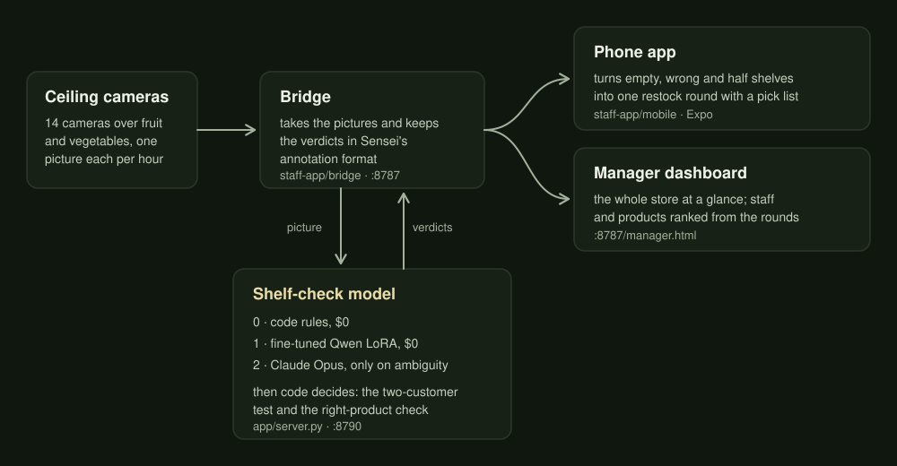
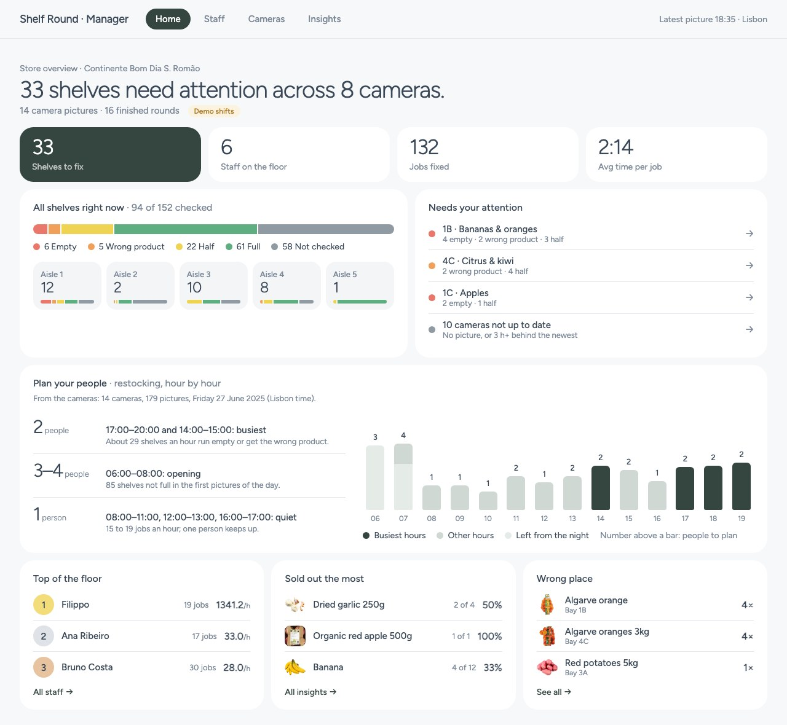
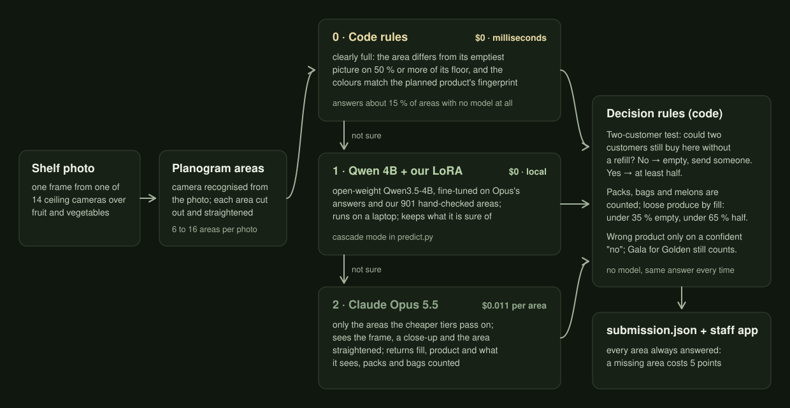
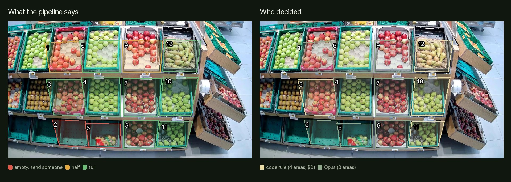
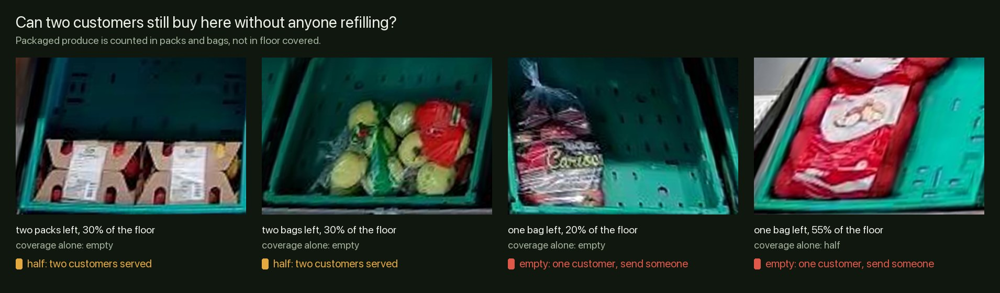
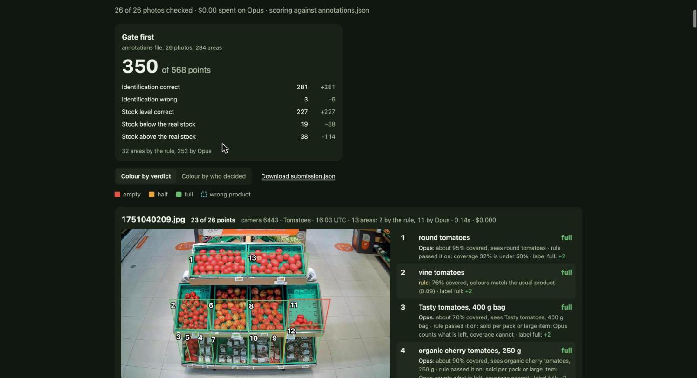

# JunctionX Lisbon 2026 Hackathon · Sensei Shelf Check

**Sensei challenge, "Fresh eyes on fresh produce".** Ceiling cameras watch the fruit and vegetable section. For every planogram area our model says whether the planned product is there (`planogram_compliant`) and whether the area is `empty`, `half` or `full`, in Sensei's annotation format. **Shelf Round**, our staff app, turns those verdicts into a restock round on the phone and a live store overview for the manager.

The idea: **spend nothing on the easy areas.** Code rules and an open-weight model we fine-tuned with LoRA run for free on a laptop. Claude Opus is only called for areas the free tiers can't settle, and plain code makes the final call, so the same answer always gives the same verdict.

## The whole system

<p align="center"></p>

A camera picture lands on the **bridge** (`staff-app/bridge`). The bridge sends it to the **shelf-check model** (`app/server.py`) and stores the verdict for every area. The **phone app** (`staff-app/mobile`) asks the bridge every few seconds and plans the round: every empty shelf on the first trip, wrong products next, half shelves to fill the rest of the cart. Finished rounds go back to the bridge, and the **manager dashboard** ranks the store, the staff and the products from them.

The dashboard also **plans the people**: from a full day of camera verdicts it counts, hour by hour, how many shelves ran empty or got the wrong product, and recommends how many people to put on restocking. On the training day that is 3 to 4 at opening (85 shelves left from the night), 2 for the peaks at 14:00 and 17:00 to 20:00, and 1 in the quiet hours (`tools/staffing_forecast.py`).

<p align="center"></p>

<sub>The manager dashboard (demo shifts), with the hour-by-hour staffing plan. The phone app and the dashboard are described in [`staff-app/README.md`](staff-app/README.md).</sub>

## The shelf-check model

<p align="center"></p>

### How it works

Each photo is matched to its camera from a thumbnail (the cameras never move). Each planogram area is then cut out and straightened. Every area goes through the tiers, cheapest first, and stops at the first one that is sure.

| Tier | What it is | Cost | Where |
|---|---|---|---|
| **0 · Code rules** | The area is compared with its own emptiest picture of the day: if 50 % or more of its floor has changed and the colours match the planned product's fingerprint, it is full. No model involved. | $0, milliseconds | `gates.py`, `gatepipe.py` |
| **1 · Qwen3.5-4B + our LoRA** | An open-weight vision model, fine-tuned by us on Opus's answers and our 901 hand-checked areas. Runs locally on Apple silicon (MLX). Keeps the areas it is sure about. | $0, local | `predict.py` (`"mode": "cascade"`), `tools/lora_train.py` |
| **2 · Claude Opus 5.5** | Only the areas the cheaper tiers pass on. It sees the whole frame with the area outlined, a close-up and the area straightened, and returns the fill, the product it sees and a short description. | $0.011 per area | `shelfcheck.py` |

The models describe, the **decision rules in code** decide:

- **The two-customer test.** Could two customers, one after the other, still buy here without anyone refilling? No: **empty**, send someone. Yes: **at least half**. Packaged products and large items (melons, pineapples, cabbages) are counted in units. Loose produce is read by fill: under 35 % is empty, under 65 % is half.
- **Wrong product** only on a confident "no". A different variety of the same fruit (Golden apples where Gala is planned) still counts as compliant, as the organisers asked.
- **Every area is always answered,** because a missing area costs 5 points: an area no tier can judge (a blocked view, a failed call) takes the training day's last verdict for that area.

<p align="center"></p>

<sub>Real output, camera 6373 (apples and pears) at 18:21. Left: the verdict per area. Right: who decided. 4 of 12 areas were settled by code for $0; Opus was asked about the other 8.</sub>

### Why it works

**Most areas are easy, so they shouldn't cost anything.** A crate heaped with apples looks full to a few lines of OpenCV. A model is only needed where the picture is genuinely unclear.

**Stock is counted the way staff count it, not the way a camera sees it.** Coverage alone gets packaged produce wrong both ways: two 1 kg bags in a large crate cover 30 % of the floor but can still serve two customers, while one 3 kg bag can cover more than half of its crate and still serve only one. The two-customer test turns "how much floor is covered" into "do we need to send someone". That's the question the staff app exists to answer.

<p align="center"></p>

**The model only describes; code decides.** Opus returns a fill estimate and what it sees, and the thresholds that turn this into a level were chosen by grouped cross-validation on our labels. Changing a rule never needs a new model call: every rule in this repo was measured offline against saved answers.

**Measured, not guessed.** 901 hand-checked areas (`labels/dev.csv`) and the official points formula (+1 right, −2 wrong product, −2 under, −3 over, −5 missing). Every decision, with its numbers, is in [`docs/decisions.md`](docs/decisions.md).

### The fine-tuned open-weight model

- **Base:** `mlx-community/Qwen3.5-4B-MLX-4bit`, open weights.
- **LoRA:** rank 16 over all 32 layers, 500 steps, 448 px crops, trained on a 16 GB MacBook with a memory-capped trainer (`tools/lora_train.py`).
- **Training data** (`tools/build_lora_dataset.py`): Opus as the teacher, overridden by our hand labels wherever a person labelled the area.
- **Weights:** the adapter (130 MB) is attached to the [`qwen-lora-run1b`](https://github.com/IshakSoltani/sensei-shelf-pipeline/releases/tag/qwen-lora-run1b) release.

```
gh release download qwen-lora-run1b -p adapters.safetensors -D models/qwen3.5-4b-shelf-lora
```

Set `"mode": "cascade"` in `config.json` and `predict.py` runs it first, handing to Opus only what it is unsure about.

### Cost

| Approach | 26 validation photos |
|---|---|
| Code rules → fine-tuned Qwen LoRA → Opus only on ambiguity (`"mode": "cascade"`) | **under €1** |

The code rules and the open-weight model run locally for nothing; Opus is billed only for the areas they pass on.

### Results

| | Points | Share of max |
|---|---|---|
| Our 901 hand-checked areas, final pipeline | 1,314 of 1,802 | 73 % |
| 26-photo stand-in for the validation set (last frames of the day) | 350 of 568 | 62 % |
| The organisers' example solution in the brief | 320 of 578 | 55 % |

Under our older coverage-only stock rule, the same pipeline scores 1,378 of 1,802 on our labels. Those labels predate the two-customer test and call one or two packs "empty". The 20 areas where they disagree with it are listed in the decision log. We kept the two-customer test because it is the organisers' own definition of empty: nobody would buy what is left.

### The model's test page and tuning panel

<p align="center"></p>

Drop the validation folder (with `annotations.json` if you have it). Every photo is judged, scored in the brief's points format, and shown with each area outlined. Each area shows its verdict, who decided it and why. **Fresh run** asks Opus again instead of reusing saved answers.

Next to the score, **Tune the decision** exposes every setting that turns the model's answers into verdicts: the code rule (on or off, and its two thresholds), the fill levels for empty and half, the two-customer test, and how strict the wrong-product flag is. Every change re-decides all photos at once from the answers already collected (no new model calls) and shows how many areas changed and, with annotations, the new score. The download uses the tuned settings. "Ask Opus about every area" (on by default) collects an answer for the areas the code rule settles too, so the code rule itself can be tuned afterwards.

## Run it

```
uv venv && uv pip install -r requirements.txt          # add -r requirements-local.txt for the local model
echo "ANTHROPIC_API_KEY=sk-ant-..." > .env
./start.sh                                             # the model (:8790) and the staff app's bridge (:8787)
cd staff-app/mobile && npm install && npx expo start --lan   # the phone app: scan the QR code with Expo Go
```

Drop camera pictures on http://127.0.0.1:8787: the model checks them and the phone app picks the results up. The manager dashboard is at http://127.0.0.1:8787/manager.html.

The organisers' dataset is not in this repo. Unzip it into `data/raw/extracted/new_dataset_hackathon_junctionx_10_oct_2026_v2/`; only the reference builder and the model's sample photos need it.

| Command | What it does |
|---|---|
| `.venv/bin/python gatepipe.py predict <folder> --api --out submission.json` | the submission run: code rules, then Opus for the rest. Photos can sit in camera folders (`6215/…`) or loose, in which case each camera is recognised from the image. Checks that every area of every photo is answered; add `--score annotations.json` to score it |
| `.venv/bin/python app/server.py --port 8790` | the model service on its own: http://127.0.0.1:8790/gates is the test run + score page |
| `.venv/bin/python predict.py <folder> --out submission.json` | Opus on every area, or the full cascade with `"mode": "cascade"` |
| `.venv/bin/python gatepipe.py check` | replays the training day from saved answers and scores it on `labels/dev.csv` (no API calls) |
| `.venv/bin/python gatepipe.py build` | rebuilds the code rules' references (emptiest picture and colour fingerprint per area) |

## Repository

| Path | What |
|---|---|
| `gatepipe.py` | the submitted pipeline: code rules first, Opus for the rest, decision rules, scoring check |
| `gates.py` | the code rules: coverage against the emptiest picture, colour fingerprint, covered-shelf check |
| `shelfcheck.py` | planogram, crops, the Opus judge with its answer cache, the prompts, the decision rules (fill thresholds, two-customer test, same kind), official scoring |
| `predict.py` | Opus on every area, or the cascade (`"mode": "cascade"`: local Qwen first, Opus where unsure) |
| `config.json` | the frozen settings: model, prompt, stock rule, two-customer test, cascade thresholds |
| `app/` | the model service (`server.py`): the test run + score page (`gates.html`), a one-photo view (`index.html`), and the `/analyze_gates` route the bridge calls |
| `staff-app/` | Shelf Round: the phone app (`mobile/`, Expo), the bridge and the manager dashboard (`bridge/`) |
| `start.sh` | starts the model and the bridge together |
| `models/qwen3.5-4b-shelf-lora/` | the LoRA adapter's config (weights in the release) |
| `tools/` | LoRA training and its dataset, local-model evaluation, cascade tuning, code-rule tuning and replay, prompt tuning, the staffing forecast |
| `data/` | planogram, English product names, camera fingerprints, the code rules' references, the training day's saved verdicts |
| `labels/dev.csv` | 901 hand-checked areas from the shared training day |
| `docs/` | the decision log and the README images |
