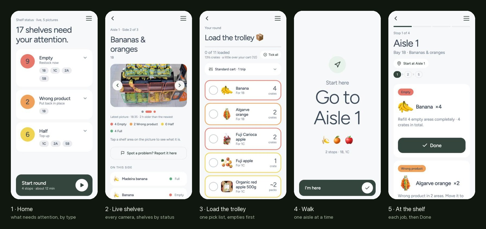

# Shelf Round · the staff app (JunctionX Lisbon 2026 Hackathon, Sensei)

Staff restock-round app for a phone, plus a store-manager dashboard for a computer.

Ceiling cameras tell us, per shelf area, if the right product is there and how full it is
(Empty / Half / Full). The app turns that into a restock round.

## Folders
| Folder | What it is |
|---|---|
| `mobile/` | The phone app (Expo / React Native, runs in Expo Go) |
| `bridge/` | Local server: drop page for camera pictures, manager dashboard, results store |
| `bridge/demo/manager-demo.html` | One-file snapshot of the dashboard (no server needed) |

## Run it
1. Model + bridge: `./start.sh` at the root of the repo (the shelf-check model on :8790, the bridge on :8787).
2. Phone app: `cd mobile && npm install && npx expo start --lan`, then scan the QR code with Expo Go (same wifi).
3. Open on the computer:
   - Drop page: http://localhost:8787
   - Manager dashboard: http://localhost:8787/manager.html
   - Refresh the one-file dashboard: `node bridge/export-demo.js`

## How the pieces fit
- Camera pictures go to the bridge, which sends each one to the shelf-check model (`../app/server.py`, `SHELF_MODEL_URL`, default http://127.0.0.1:8790) and keeps the verdicts in `bridge/data/results.json` (same format as the challenge's `annotations.json`). Who decided each area (code rule or model) and what was seen go to `bridge/data/details.json`. If the model is not running, the bridge falls back to one Claude call per photo when `ANTHROPIC_API_KEY` is set.
- The phone app asks the bridge for results every few seconds and shows real pictures; without the bridge it uses demo data.
- Finished rounds are sent from the phone to the bridge (`bridge/data/rounds.json`); the dashboard ranks staff from them.
- Product pictures come from the Continente online catalogue (`mobile/assets/products`, sources in `bridge/data/product-images.json`). Prototype only: ask before publishing.
- Data files from the official planogram: `mobile/src/data/*` (built with a script; 14 cameras, 152 shelf areas, 94 products).

## Rules built into the planner (`mobile/src/logic/tasks.js`)
- Empty = red, Wrong product = orange, Half = yellow.
- Cart default 12 crates (Small 8 / Standard 12 / Large 16 on the pick list). Heavy items go on the pallet truck.
- Every Empty job is in the first trip; Wrong product next when it fits; Half fills the rest. Up to 15% over the cart stays one trip.
- Same product in several shelf areas of one bay = one job ("Banana ×4").
- The plan is made once and never changed during a round.

## Open ideas for next time
- "How many fit?" correction on a job, so staff teach the app real pack sizes.
- Time slider ("view the shop at 14:00"); stale-camera greying.
- Live "on a round now" view for the manager; ranking that includes loading time everywhere.
- Aisle names: the 5 aisles are my grouping of the cameras; confirm the real grouping.
